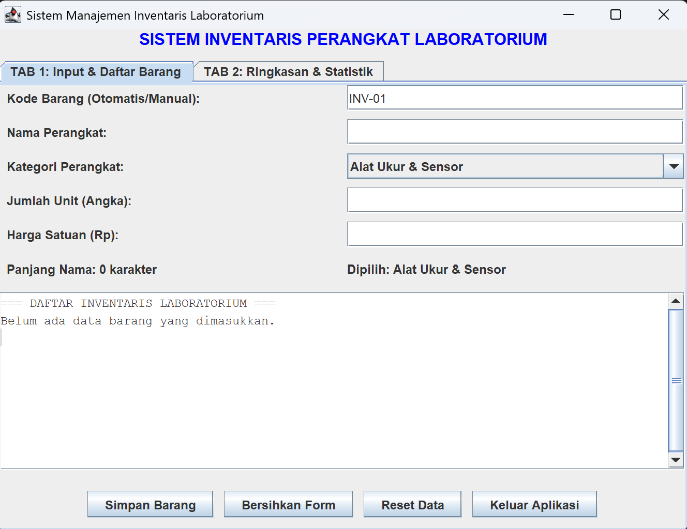
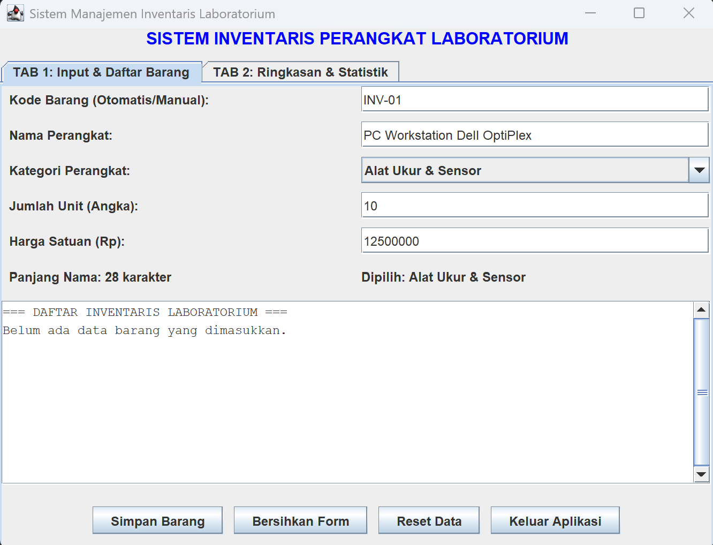
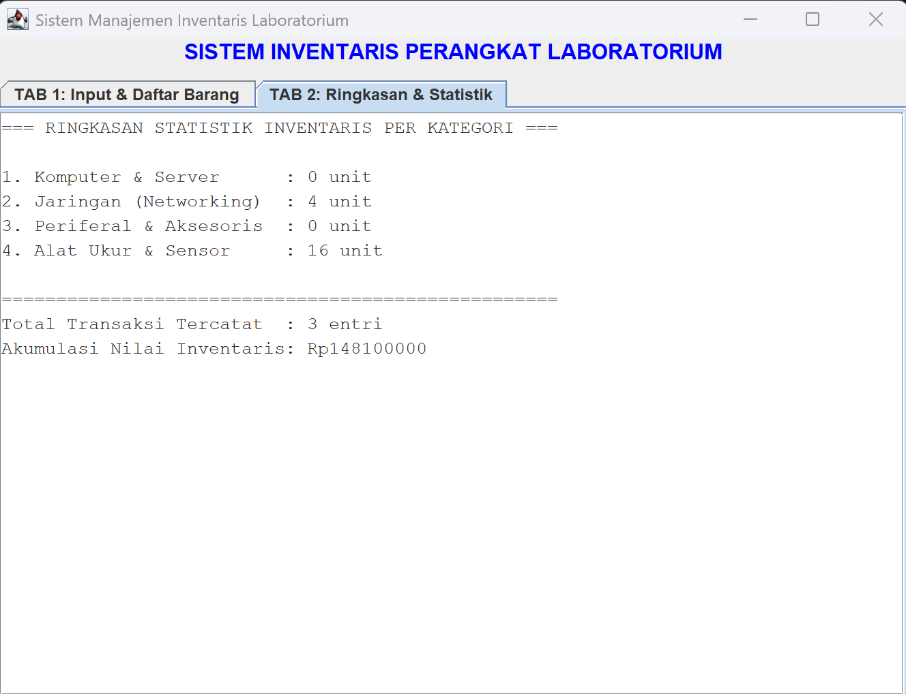
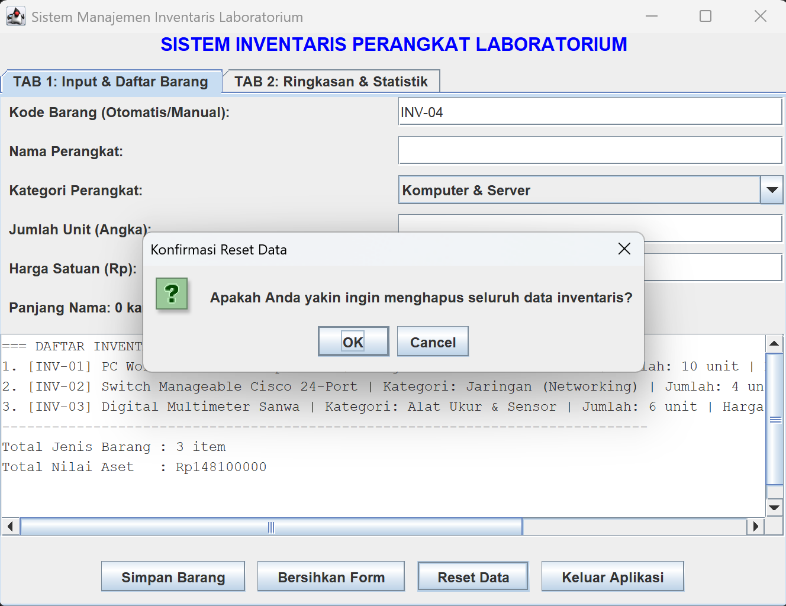
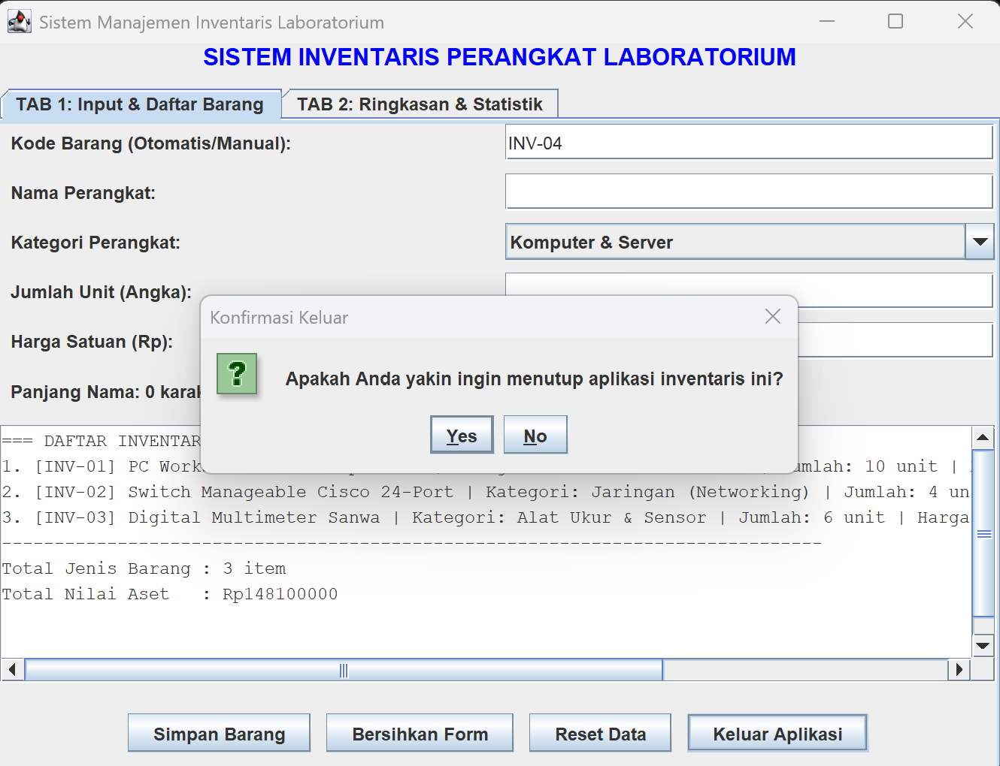

# Tugas GUI Pemrograman Berorientasi Objek - Sistem Manajemen Inventaris Laboratorium

Repositori ini berisi implementasi program **Graphical User Interface (GUI)** menggunakan pustaka **Java Swing (`javax.swing.*`)** dan **AWT (`java.awt.*`)** untuk memenuhi tugas mata kuliah Pemrograman Berorientasi Objek (Pertemuan 10).

## Identitas Mahasiswa
* **Nama:** Jauda Avaro Zufaru
* **NIM:** F1D02410059
* **Kelas:** 5C - Teknik Informatika

---

## Struktur Proyek
Program dirancang secara modular menggunakan prinsip *Object-Oriented Programming* (Encapsulation, Object Relationship, dan Multiple Interface Implementation):
* `src/ItemInventaris.java` — Kelas model/entitas untuk merepresentasikan objek barang inventaris beserta perhitungan nilai asetnya.
* `src/InventarisFrame.java` — Kelas utama pembangun antarmuka GUI, pengatur *layout*, dan penangan *event* (*Event Handler*).
* `src/Main.java` — Kelas *driver* yang berisi *method* `main` untuk mengeksekusi aplikasi.

---

## Pemenuhan Syarat Komponen GUI & Event Handling

Berdasarkan ketentuan tugas dan materi perkuliahan, berikut adalah rincian komponen yang digunakan di dalam kode:

### 1. Top-Level Container
* **`JFrame` (`frameUtama`):** Jendela utama aplikasi yang dikonfigurasi dengan `JFrame.EXIT_ON_CLOSE` agar aplikasi tertutup dan dihapus dari memori saat tombol *close* ditekan. Seluruh penambahan komponen dan pengaturan *layout* dilakukan melalui *Content Pane* (`frameUtama.getContentPane()`).
* **`JOptionPane`:** Digunakan untuk menampilkan dialog interaktif (`showMessageDialog` dan `showConfirmDialog`) lengkap dengan variasi tipe tombol (`OK_CANCEL_OPTION`, `YES_NO_OPTION`) dan ikon (`WARNING_MESSAGE`, `ERROR_MESSAGE`, `INFORMATION_MESSAGE`, `QUESTION_MESSAGE`).

### 2. Intermediate Component (Container)
* **`JTabbedPane` (`tabKontainer`):** Kontainer bertab untuk memisahkan tampilan antara **Tab 1 (Input & Daftar Barang)** dan **Tab 2 (Ringkasan & Statistik)**.
* **`JPanel` (`panelTabUtama`, `panelFormInput`, `panelTombolAksi`, `panelTabStatistik`):** Kontainer perantara untuk mengelompokkan formulir input, deretan tombol aksi, dan halaman statistik.
* **`JScrollPane` (`scrollPaneDaftar`):** Kontainer penggulung (*scroll bar*) yang membungkus area teks agar daftar inventaris yang panjang tetap dapat digulir dengan rapi.

### 3. Atomic Component
* **`JLabel`:** Menampilkan judul utama, label instruksi setiap *field* input, indikator jumlah karakter *real-time*, serta informasi kategori yang aktif.
* **`JTextField`:** Menerima masukan teks dari pengguna berupa Kode Barang, Nama Perangkat, Jumlah Unit, dan Harga Satuan.
* **`JComboBox`:** Menyediakan menu pilihan (*dropdown*) untuk memilih kategori perangkat laboratorium.
* **`JButton`:** Tombol interaktif untuk mengeksekusi aksi *Simpan Barang*, *Bersihkan Form*, *Reset Data*, dan *Keluar Aplikasi*.
* **`JTextArea`:** Menampilkan daftar inventaris yang tersimpan pada Tab 1 serta rekapitulasi statistik kategori pada Tab 2.

### 4. Layout Manager
* **`BorderLayout`:** Digunakan pada `ContentPane` dari `frameUtama` (menempatkan judul di `NORTH` dan tab di `CENTER`) serta pada `panelTabUtama` (membagi area form di `NORTH`, area daftar di `CENTER`, dan tombol di `SOUTH`).
* **`GridLayout(6, 2)`:** Digunakan pada `panelFormInput` untuk menyusun pasangan label dan kolom input secara rapi dalam 6 baris dan 2 kolom dengan jarak horizontal (`Hgap`) dan vertikal (`Vgap`) yang presisi.
* **`FlowLayout(FlowLayout.CENTER)`:** Digunakan pada `panelTombolAksi` untuk menyusun keempat tombol aksi secara berurutan dari kiri ke kanan dengan perataan tengah.

### 5. Event Handling (Menggunakan 3 Interface Java)
Kelas `InventarisFrame` mengimplementasikan konsep *Multiple Inheritance* melalui 3 *interface* sekaligus (`implements ActionListener, ItemListener, KeyListener`):
1. **`ActionListener` (`java.awt.event.ActionListener`):** Menangani aksi penekanan pada keempat komponen `JButton` melalui *override method* `actionPerformed(ActionEvent event)`.
2. **`ItemListener` (`java.awt.event.ItemListener`):** Menangani perubahan pilihan kategori secara langsung pada komponen `JComboBox` melalui *override method* `itemStateChanged(ItemEvent event)`.
3. **`KeyListener` (`java.awt.event.KeyListener`):** Menangani interaksi papan ketik (*keyboard*) melalui *override method*:
   * `keyTyped(KeyEvent event)`: Memvalidasi agar kolom Jumlah Unit dan Harga Satuan hanya dapat diisi karakter angka (*digit*).
   * `keyReleased(KeyEvent event)`: Menghitung panjang karakter Nama Perangkat secara *real-time* saat pengguna mengetik.
   * `keyPressed(KeyEvent event)`: Memungkinkan penyimpanan cepat saat pengguna menekan tombol `Enter` pada kolom Harga Satuan.

---

## Dokumentasi Tampilan Program (Screenshots)

### 1. Tampilan Awal Aplikasi (Tab 1)


### 2. Proses Input & Daftar Barang Inventaris


### 3. Tampilan Ringkasan & Statistik Kategori (Tab 2)


### 4. Dialog Validasi & Konfirmasi (`JOptionPane`)


### 5. Dialog Validasi & Konfirmasi Keluar(`JOptionPane`)


---

## Cara Kompilasi dan Menjalankan Program
Buka terminal pada direktori utama proyek, lalu jalankan perintah berikut:

```bash
javac -d bin src/*.java
java -cp bin Main