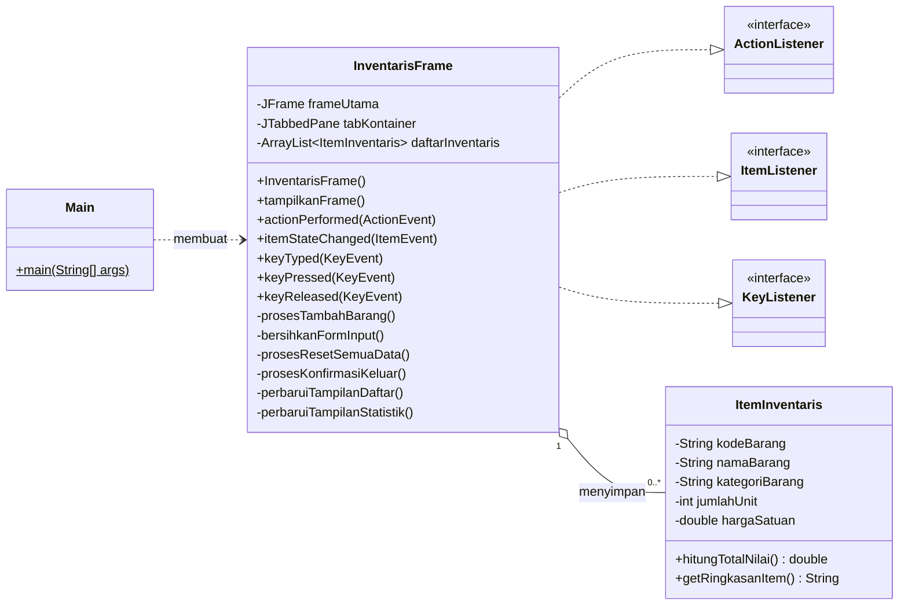
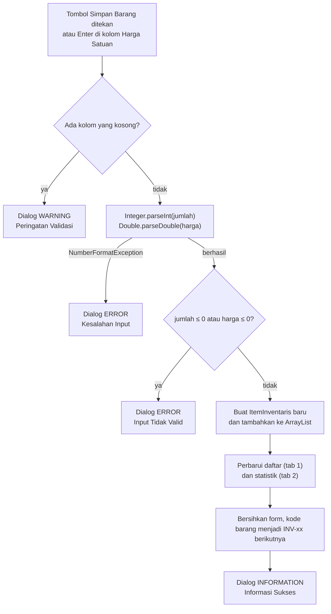
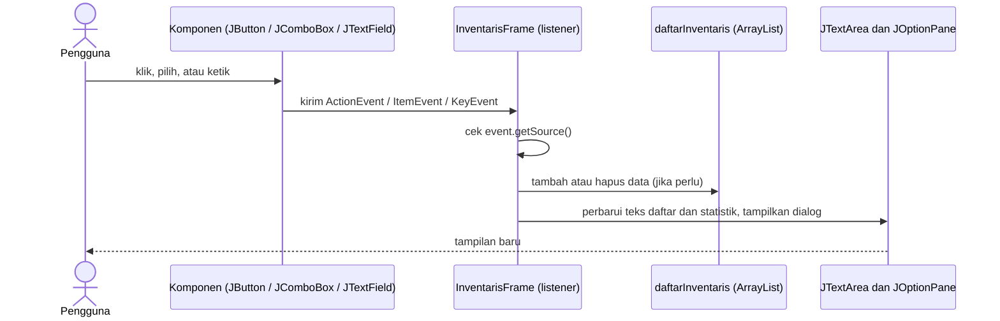
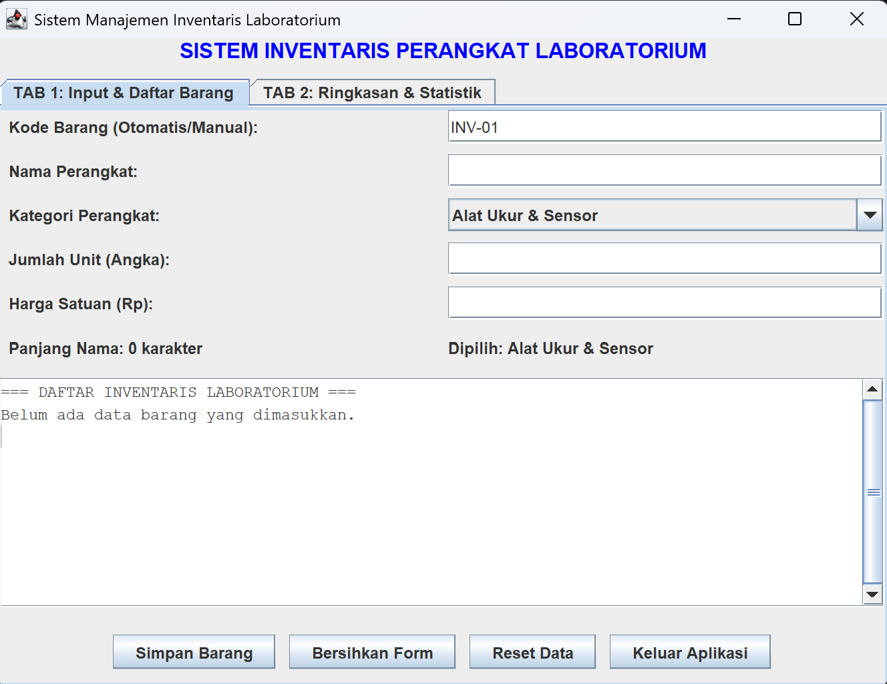
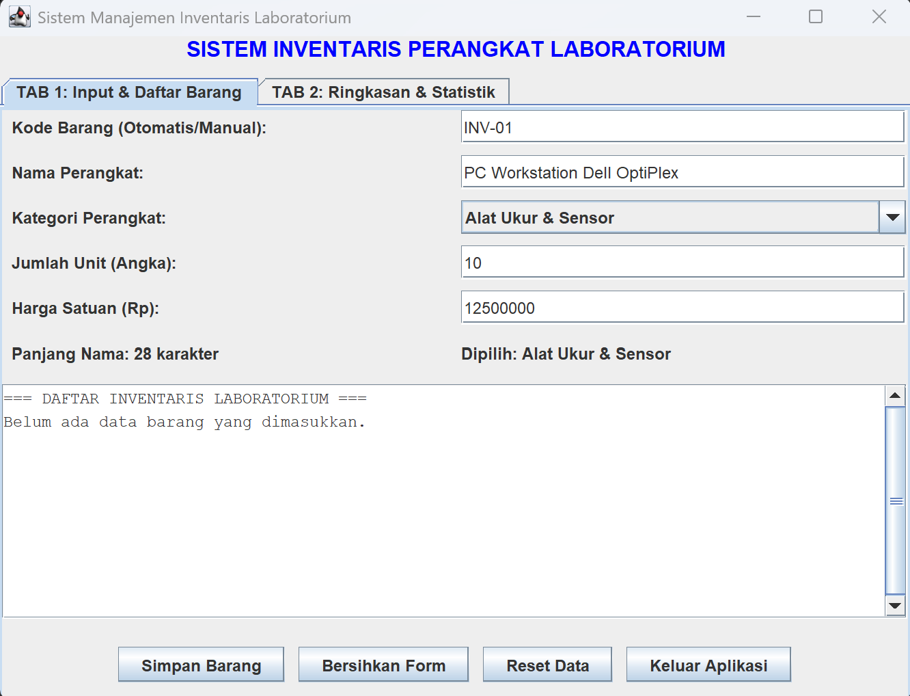
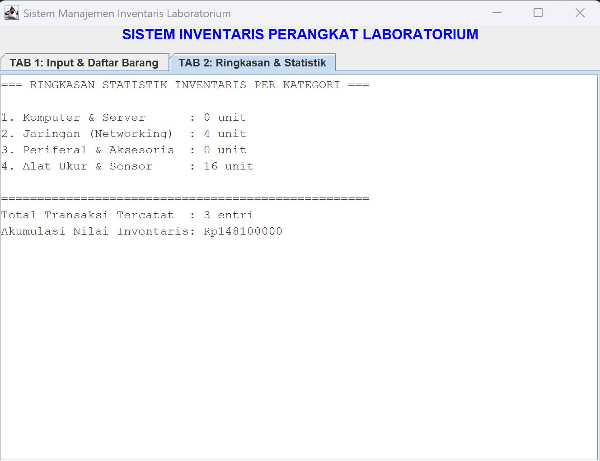
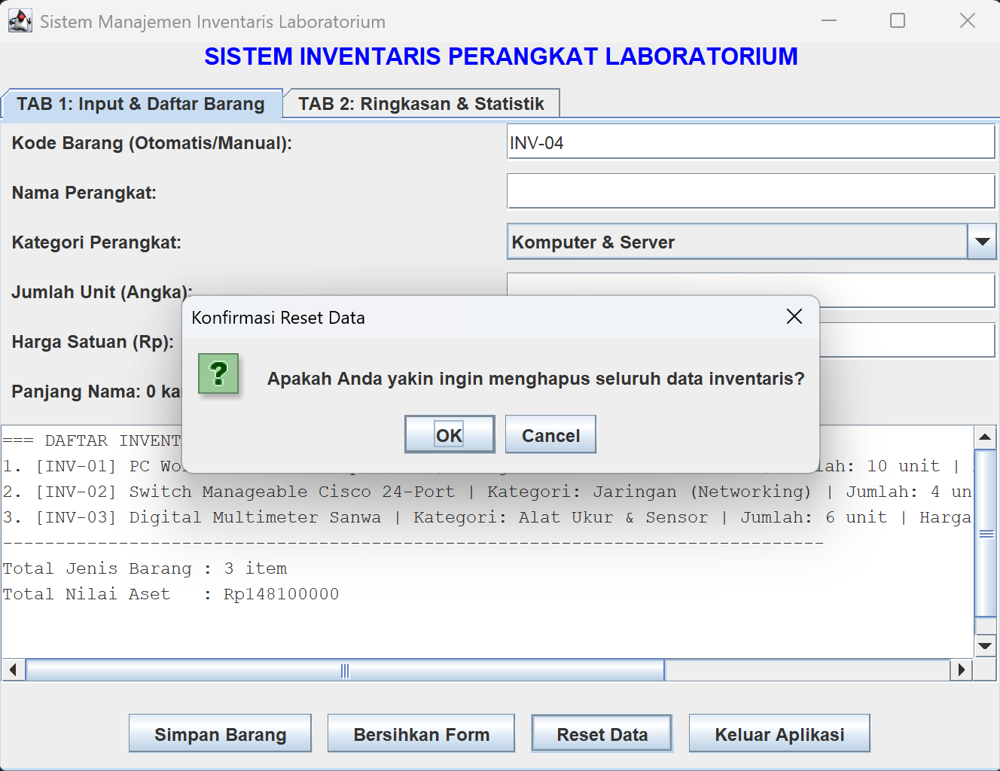
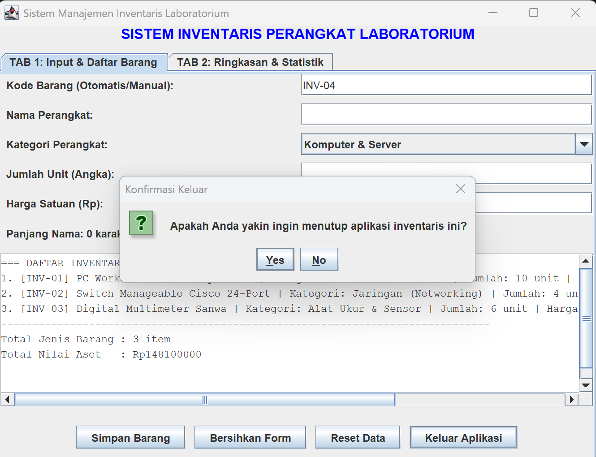

# LATIHAN PEMROGRAMAN BERORIENTASI OBJEK: GRAPHICAL USER INTERFACE (GUI) PADA JAVA

### Sistem Manajemen Inventaris Perangkat Laboratorium dengan Java Swing


Aplikasi desktop untuk mencatat perangkat laboratorium, misalnya PC, switch jaringan, atau multimeter, beserta kategori, jumlah unit, dan harga satuannya. Setiap barang yang disimpan langsung muncul di daftar inventaris, dan rekap jumlah unit per kategori serta total nilai aset dihitung ulang secara otomatis di tab kedua. Seluruh antarmuka dibangun dengan **Java Swing** dan **AWT** tanpa GUI builder, sehingga setiap komponen, layout, dan listener dapat ditelusuri langsung di kode. Program ini memenuhi kelima syarat latihan, yaitu Top-Level Container, Intermediate Component, Atomic Component, Layout Manager, dan Event Handling, dengan memakai **tiga** interface listener sekaligus (`ActionListener`, `ItemListener`, dan `KeyListener`), satu lebih banyak dari syarat minimal.

---

## Daftar Isi

1. [Identitas](#1-identitas)
2. [Perintah Tugas dan Pemenuhannya](#2-perintah-tugas-dan-pemenuhannya)
3. [Deskripsi Program](#3-deskripsi-program)
4. [Struktur Proyek dan Rancangan Kelas](#4-struktur-proyek-dan-rancangan-kelas)
5. [Hierarki Komponen GUI](#5-hierarki-komponen-gui)
6. [Top-Level Container](#6-top-level-container)
7. [Intermediate Component](#7-intermediate-component)
8. [Atomic Component](#8-atomic-component)
9. [Layout Manager](#9-layout-manager)
10. [Event Handling](#10-event-handling)
11. [Cara Menjalankan Program](#11-cara-menjalankan-program)
12. [Skenario Pengujian dan Screenshot](#12-skenario-pengujian-dan-screenshot)
13. [Catatan Perancangan dan Batasan](#13-catatan-perancangan-dan-batasan)

---

## 1. Identitas

| | |
|---|---|
| **Nama** | Jauda Avaro Zufaru |
| **NIM** | F1D02410059 |
| **Kelas** | C |
| **Mata kuliah** | Pemrograman Berorientasi Objek (MBS1302137) |
| **Dosen pengampu** | Royana Afwani, S.T., M.T. |
| **Program studi** | Teknik Informatika, Fakultas Teknik, Universitas Mataram |
| **Tugas** | Latihan Materi GUI - 5C |

---

## 2. Perintah Tugas dan Pemenuhannya

Perintah latihan pada forum Berajah meminta mahasiswa membuat GUI yang di dalamnya minimal terdapat Top-Level Container, Intermediate Component, Atomic Component, Layout Manager, dan Event Handling dari minimal dua interface Java. Repositori harus berisi kode dan README yang menjelaskan kelima hal tersebut beserta screenshot. Tabel berikut merangkum di mana setiap syarat dipenuhi.

| Syarat | Dipenuhi oleh | Uraian |
|---|---|---|
| Top-Level Container | `JFrame`, dialog dari `JOptionPane` | [Bagian 6](#6-top-level-container) |
| Intermediate Component | `JTabbedPane`, 4 `JPanel`, 2 `JScrollPane` | [Bagian 7](#7-intermediate-component) |
| Atomic Component | `JLabel`, `JTextField`, `JComboBox`, `JButton`, `JTextArea` | [Bagian 8](#8-atomic-component) |
| Layout Manager | `BorderLayout`, `GridLayout`, `FlowLayout` | [Bagian 9](#9-layout-manager) |
| Event Handling (minimal 2 interface) | `ActionListener`, `ItemListener`, `KeyListener` (3 interface) | [Bagian 10](#10-event-handling) |
| Screenshot | 5 tangkapan layar di folder `screenshots/` | [Bagian 12](#12-skenario-pengujian-dan-screenshot) |

---

## 3. Deskripsi Program

Aplikasi terdiri atas satu jendela dengan dua tab. Tab pertama, **Input & Daftar Barang**, berisi formulir untuk kode barang, nama perangkat, kategori, jumlah unit, dan harga satuan, lalu di bawahnya ada area daftar inventaris dan deretan tombol aksi. Tab kedua, **Ringkasan & Statistik**, menampilkan jumlah unit di setiap kategori, jumlah entri yang tercatat, dan akumulasi nilai seluruh inventaris.

Kategori perangkat yang tersedia ada empat: Komputer & Server, Jaringan (Networking), Periferal & Aksesoris, serta Alat Ukur & Sensor. Kode barang terisi otomatis dengan pola `INV-01`, `INV-02`, dan seterusnya, tetapi tetap dapat diubah manual. Nilai total sebuah barang dihitung sebagai jumlah unit dikali harga satuan.

Fitur yang dapat dicoba pengguna:

| Fitur | Cara memicu | Hasil |
|---|---|---|
| Simpan barang | Tombol **Simpan Barang**, atau tekan `Enter` di kolom Harga Satuan | Data divalidasi, ditambahkan ke daftar, statistik diperbarui, form dikosongkan, kode barang naik satu |
| Bersihkan form | Tombol **Bersihkan Form** | Nama, jumlah, dan harga dikosongkan, kategori kembali ke pilihan pertama |
| Reset data | Tombol **Reset Data** | Muncul konfirmasi OK/Cancel; jika OK, semua data dihapus dan kode kembali ke `INV-01` |
| Keluar | Tombol **Keluar Aplikasi** | Muncul konfirmasi Yes/No; jika Yes, aplikasi ditutup |
| Info kategori langsung | Mengganti pilihan kategori | Label di bawah form berubah menjadi `Dipilih: <kategori>` |
| Penghitung karakter | Mengetik di kolom Nama Perangkat | Label `Panjang Nama: n karakter` diperbarui setiap tombol dilepas |
| Filter angka | Mengetik di kolom Jumlah Unit atau Harga Satuan | Karakter selain angka diabaikan |

Program hanya memakai pustaka bawaan Java: `javax.swing.*` untuk komponen antarmuka, `java.awt.*` untuk layout, warna, dan font, `java.awt.event.*` untuk listener dan event, serta `java.util.ArrayList` untuk menyimpan daftar barang.

---

## 4. Struktur Proyek dan Rancangan Kelas

### 4.1 Struktur Folder

```text
Latihan-Graphical-User-Interfaces--GUI--pada-Java/
├── src/
│   ├── Main.java              # titik masuk program, membuat dan menampilkan jendela
│   ├── InventarisFrame.java   # seluruh komponen GUI, layout, dan event handler
│   └── ItemInventaris.java    # kelas model untuk satu barang inventaris
├── bin/                       # hasil kompilasi (.class)
├── screenshots/               # bukti tampilan program
└── README.md
```

### 4.2 Diagram Kelas



### 4.3 Peran Setiap Kelas

| Kelas | Peran | Isi utama |
|---|---|---|
| `Main` | Kelas *driver* | Membuat objek `InventarisFrame` lalu memanggil `tampilkanFrame()` |
| `InventarisFrame` | Antarmuka sekaligus pengendali event | Mendeklarasikan semua komponen sebagai atribut `private`, menyusunnya di `inisialisasiKomponenGUI()`, dan mengimplementasikan tiga interface listener |
| `ItemInventaris` | Kelas model (entitas) | Lima atribut `private` yang hanya dibaca lewat getter, `hitungTotalNilai()` untuk jumlah × harga, dan `getRingkasanItem()` untuk teks satu baris di daftar |

Pemisahan ini membuat data barang tidak bergantung pada tampilan. `ItemInventaris` tidak mengenal Swing sama sekali, sedangkan `InventarisFrame` hanya menyimpan daftar objek `ItemInventaris` di dalam `ArrayList` dan membangun teks tampilan dari objek-objek tersebut.

---

## 5. Hierarki Komponen GUI

Diagram berikut menunjukkan komponen mana yang menampung komponen lain beserta layout manager yang dipakai setiap kontainer. Membaca hierarki ini dari atas ke bawah sama dengan membaca urutan pembuatan komponen di `inisialisasiKomponenGUI()`.

```text
JFrame  frameUtama  "Sistem Manajemen Inventaris Laboratorium"         ← Top-Level Container
└── Content Pane                                   [BorderLayout(10, 10)]
    ├── NORTH   JLabel labelJudulHeader  "SISTEM INVENTARIS PERANGKAT LABORATORIUM"
    └── CENTER  JTabbedPane tabKontainer
        ├── Tab 1  JPanel panelTabUtama            [BorderLayout(10, 10)]
        │   ├── NORTH   JPanel panelFormInput      [GridLayout(6, 2), hgap 10, vgap 8]
        │   │   ├── JLabel labelKodeBarang        │ JTextField fieldKodeBarang
        │   │   ├── JLabel labelNamaBarang        │ JTextField fieldNamaBarang
        │   │   ├── JLabel labelKategoriBarang    │ JComboBox  comboKategoriBarang
        │   │   ├── JLabel labelJumlahUnit        │ JTextField fieldJumlahUnit
        │   │   ├── JLabel labelHargaSatuan       │ JTextField fieldHargaSatuan
        │   │   └── JLabel labelStatusKarakter    │ JLabel     labelInfoKategori
        │   ├── CENTER  JScrollPane scrollPaneDaftar
        │   │   └── JTextArea areaDaftarInventaris
        │   └── SOUTH   JPanel panelTombolAksi     [FlowLayout(CENTER), hgap 10, vgap 10]
        │       ├── JButton tombolTambah      "Simpan Barang"
        │       ├── JButton tombolBersihkan   "Bersihkan Form"
        │       ├── JButton tombolHapusSemua  "Reset Data"
        │       └── JButton tombolKeluar      "Keluar Aplikasi"
        └── Tab 2  JPanel panelTabStatistik        [BorderLayout(10, 10)]
            └── CENTER  JScrollPane (tanpa nama variabel)
                └── JTextArea areaRingkasanStatistik

JDialog modal dari JOptionPane (validasi, info, dan konfirmasi)        ← Top-Level Container
```

---

## 6. Top-Level Container

Top-level container adalah komponen paling luar yang dapat tampil sendiri di layar dan menjadi akar dari seluruh komponen lain. Program ini memakai dua jenis.

### 6.1 `JFrame` sebagai Jendela Utama

```java
frameUtama = new JFrame("Sistem Manajemen Inventaris Laboratorium");
frameUtama.setDefaultCloseOperation(JFrame.EXIT_ON_CLOSE);
frameUtama.getContentPane().setLayout(new BorderLayout(10, 10));
```

Judul jendela diberikan lewat konstruktor. `EXIT_ON_CLOSE` membuat program benar-benar berhenti ketika tombol silang di pojok jendela ditekan, bukan hanya menyembunyikan jendelanya. Komponen tidak ditambahkan langsung ke frame, melainkan ke **content pane** yang diambil dengan `getContentPane()`, sesuai cara kerja `JFrame`. Ukuran, posisi, dan visibilitas diatur terpisah di method `tampilkanFrame()`:

```java
frameUtama.setSize(680, 520);
frameUtama.setLocationRelativeTo(null);   // jendela muncul di tengah layar
frameUtama.setVisible(true);
```

### 6.2 Dialog dari `JOptionPane`

Method statis `JOptionPane.showMessageDialog()` dan `JOptionPane.showConfirmDialog()` membuat sebuah `JDialog` modal, yaitu jendela top-level kedua yang menahan interaksi dengan jendela utama sampai dialog ditutup. Semua dialog memakai `frameUtama` sebagai induk sehingga muncul di tengah jendela aplikasi. Program memakai delapan dialog dengan variasi tipe tombol dan ikon:

| Situasi | Method | Tombol | Ikon | Judul dialog |
|---|---|---|---|---|
| Ada kolom input yang kosong | `showMessageDialog` | OK | `WARNING_MESSAGE` | Peringatan Validasi |
| Jumlah atau harga bernilai nol | `showMessageDialog` | OK | `ERROR_MESSAGE` | Input Tidak Valid |
| Teks jumlah atau harga gagal dikonversi menjadi angka | `showMessageDialog` | OK | `ERROR_MESSAGE` | Kesalahan Input |
| Barang berhasil disimpan | `showMessageDialog` | OK | `INFORMATION_MESSAGE` | Informasi Sukses |
| Reset ditekan saat daftar masih kosong | `showMessageDialog` | OK | `INFORMATION_MESSAGE` | Informasi |
| Konfirmasi hapus semua data | `showConfirmDialog` | `OK_CANCEL_OPTION` | `QUESTION_MESSAGE` | Konfirmasi Reset Data |
| Data berhasil dihapus | `showMessageDialog` | OK | `INFORMATION_MESSAGE` | Pilihan Anda |
| Konfirmasi keluar aplikasi | `showConfirmDialog` | `YES_NO_OPTION` | `QUESTION_MESSAGE` | Konfirmasi Keluar |

Nilai yang dikembalikan `showConfirmDialog` dibandingkan dengan `JOptionPane.OK_OPTION` atau `JOptionPane.YES_OPTION`, sehingga aksi berbahaya seperti menghapus data dan menutup aplikasi hanya dijalankan jika pengguna benar-benar setuju.

---

## 7. Intermediate Component

Intermediate component adalah kontainer perantara. Komponen ini tidak berdiri sendiri seperti `JFrame`, tetapi dipakai untuk mengelompokkan komponen lain agar tata letaknya bisa diatur per bagian.

| Komponen | Variabel | Layout di dalamnya | Isi dan fungsi |
|---|---|---|---|
| `JTabbedPane` | `tabKontainer` | dikelola sendiri oleh tab | Memisahkan halaman **TAB 1: Input & Daftar Barang** dan **TAB 2: Ringkasan & Statistik**. Ditambahkan ke posisi `CENTER` content pane |
| `JPanel` | `panelTabUtama` | `BorderLayout` | Isi tab 1, membagi area menjadi form (atas), daftar (tengah), dan tombol (bawah) |
| `JPanel` | `panelFormInput` | `GridLayout(6, 2)` | Mengelompokkan enam pasang label dan kolom input |
| `JPanel` | `panelTombolAksi` | `FlowLayout` | Mengelompokkan empat tombol aksi dalam satu baris |
| `JPanel` | `panelTabStatistik` | `BorderLayout` | Isi tab 2, menampung area statistik |
| `JScrollPane` | `scrollPaneDaftar` | dikelola sendiri | Membungkus `areaDaftarInventaris` agar daftar yang panjang atau lebar dapat digulir secara vertikal dan horizontal |
| `JScrollPane` | tanpa nama (dibuat langsung) | dikelola sendiri | Membungkus `areaRingkasanStatistik` di tab 2 |

Tab dibuat dengan `tabKontainer.add(komponen, judul)`. Karena setiap tab cukup diisi satu `JPanel`, seluruh susunan di dalam tab bisa diatur dengan layout milik panel tersebut.

```java
tabKontainer = new JTabbedPane();
tabKontainer.add(panelTabUtama, "TAB 1: Input & Daftar Barang");
tabKontainer.add(panelTabStatistik, "TAB 2: Ringkasan & Statistik");
```

---

## 8. Atomic Component

Atomic component adalah komponen paling dasar yang langsung dilihat atau dipakai pengguna dan tidak menampung komponen lain.

| Komponen | Jumlah | Variabel | Fungsi |
|---|---|---|---|
| `JLabel` | 8 | `labelJudulHeader` | Judul besar berwarna biru, font Arial tebal 16, rata tengah |
| | | `labelKodeBarang`, `labelNamaBarang`, `labelKategoriBarang`, `labelJumlahUnit`, `labelHargaSatuan` | Keterangan di samping setiap kolom input |
| | | `labelStatusKarakter` | Menampilkan panjang nama perangkat secara langsung (diperbarui oleh `KeyListener`) |
| | | `labelInfoKategori` | Menampilkan kategori yang sedang dipilih (diperbarui oleh `ItemListener`) |
| `JTextField` | 4 | `fieldKodeBarang` | Kode barang, berisi `INV-01` sejak awal dan naik otomatis |
| | | `fieldNamaBarang` | Nama perangkat |
| | | `fieldJumlahUnit` | Jumlah unit, hanya menerima angka |
| | | `fieldHargaSatuan` | Harga satuan dalam rupiah, hanya menerima angka, `Enter` langsung menyimpan |
| `JComboBox<String>` | 1 | `comboKategoriBarang` | Daftar pilihan empat kategori perangkat |
| `JButton` | 4 | `tombolTambah`, `tombolBersihkan`, `tombolHapusSemua`, `tombolKeluar` | Simpan Barang, Bersihkan Form, Reset Data, Keluar Aplikasi |
| `JTextArea` | 2 | `areaDaftarInventaris` | Daftar barang tersimpan, font Monospaced, `setEditable(false)` |
| | | `areaRingkasanStatistik` | Rekap per kategori, font Monospaced, `setEditable(false)` |

Kedua `JTextArea` dibuat tidak dapat diedit karena isinya merupakan hasil olahan program. Pengguna hanya mengubah data melalui form, sehingga isi daftar selalu konsisten dengan `ArrayList` di belakangnya. Font Monospaced dipakai agar kolom-kolom teks di daftar dan statistik sejajar.

---

## 9. Layout Manager

Layout manager menentukan posisi dan ukuran komponen di dalam sebuah kontainer, sehingga tampilan tetap rapi saat jendela diubah ukurannya. Program memakai tiga jenis layout yang saling bersarang.

| Layout | Dipakai pada | Pengaturan | Alasan dipilih |
|---|---|---|---|
| `BorderLayout` | Content pane `frameUtama` | `(10, 10)`, judul di `NORTH`, tab di `CENTER` | Judul cukup setinggi teksnya, sedangkan area tab mengambil seluruh sisa ruang |
| `BorderLayout` | `panelTabUtama` | `(10, 10)`, form di `NORTH`, daftar di `CENTER`, tombol di `SOUTH` | Form dan tombol tetap ukurannya, sedangkan area daftar ikut membesar ketika jendela diperbesar |
| `BorderLayout` | `panelTabStatistik` | `(10, 10)`, area statistik di `CENTER` | Area statistik memenuhi seluruh tab |
| `GridLayout` | `panelFormInput` | `6` baris × `2` kolom, `setHgap(10)`, `setVgap(8)` | Setiap label sejajar dengan kolom inputnya dan semua sel berukuran sama |
| `FlowLayout` | `panelTombolAksi` | `FlowLayout.CENTER`, `setHgap(10)`, `setVgap(10)` | Tombol disusun berurutan dari kiri ke kanan dan dirata tengah |

Pada `GridLayout`, urutan `add()` menentukan posisi sel, yaitu mengisi baris pertama dari kiri ke kanan lalu turun ke baris berikutnya. Karena itu label dan kolom input ditambahkan berpasangan:

```java
GridLayout layoutForm = new GridLayout(6, 2);
layoutForm.setHgap(10);
layoutForm.setVgap(8);
panelFormInput.setLayout(layoutForm);

panelFormInput.add(labelKodeBarang);      // baris 1, kolom 1
panelFormInput.add(fieldKodeBarang);      // baris 1, kolom 2
panelFormInput.add(labelNamaBarang);      // baris 2, kolom 1
// ... dan seterusnya sampai baris 6
```

---

## 10. Event Handling

### 10.1 Konsep yang Dipakai

Event handling di Java mengikuti pola **delegasi**. Komponen yang menjadi sumber event (misalnya `JButton`) tidak menangani kejadiannya sendiri, melainkan meneruskannya ke objek *listener* yang sudah didaftarkan. Objek listener wajib mengimplementasikan interface yang sesuai, karena interface itulah yang menjamin method penanganan event benar-benar ada.

Kelas `InventarisFrame` mengimplementasikan tiga interface sekaligus. Java tidak mengizinkan sebuah kelas mewarisi lebih dari satu kelas, tetapi sebuah kelas boleh mengimplementasikan banyak interface:

```java
public class InventarisFrame implements ActionListener, ItemListener, KeyListener {
```

Karena kelas ini sendiri yang menjadi listener, pendaftarannya memakai `this`:

```java
tombolTambah.addActionListener(this);
tombolBersihkan.addActionListener(this);
tombolHapusSemua.addActionListener(this);
tombolKeluar.addActionListener(this);

comboKategoriBarang.addItemListener(this);

fieldNamaBarang.addKeyListener(this);
fieldJumlahUnit.addKeyListener(this);
fieldHargaSatuan.addKeyListener(this);
```

Satu listener melayani beberapa komponen, sehingga di dalam setiap method dipakai `event.getSource()` untuk mengetahui komponen mana yang memicu event.

### 10.2 Ringkasan Interface dan Method

| Interface | Paket | Method yang di-*override* | Didaftarkan pada | Perilaku |
|---|---|---|---|---|
| `ActionListener` | `java.awt.event` | `actionPerformed(ActionEvent)` | 4 `JButton` | Menjalankan proses simpan, bersihkan, reset, atau keluar sesuai tombol yang ditekan |
| `ItemListener` | `java.awt.event` | `itemStateChanged(ItemEvent)` | `JComboBox` kategori | Memperbarui `labelInfoKategori` menjadi `Dipilih: <kategori>` |
| `KeyListener` | `java.awt.event` | `keyTyped(KeyEvent)` | kolom Jumlah Unit dan Harga Satuan | Membuang karakter yang bukan angka |
| | | `keyPressed(KeyEvent)` | kolom Harga Satuan | Menekan `Enter` langsung menyimpan barang |
| | | `keyReleased(KeyEvent)` | kolom Nama Perangkat | Menghitung ulang panjang nama dan menampilkannya di `labelStatusKarakter` |

### 10.3 `ActionListener`

```java
@Override
public void actionPerformed(ActionEvent event) {
    Object sumberAksi = event.getSource();

    if (sumberAksi == tombolTambah) {
        prosesTambahBarang();
    } else if (sumberAksi == tombolBersihkan) {
        bersihkanFormInput();
    } else if (sumberAksi == tombolHapusSemua) {
        prosesResetSemuaData();
    } else if (sumberAksi == tombolKeluar) {
        prosesKonfirmasiKeluar();
    }
}
```

Method ini sengaja hanya berisi percabangan, sedangkan pekerjaan sebenarnya dipindahkan ke method `private` tersendiri. Dengan begitu, proses yang sama dapat dipanggil dari tempat lain. Contohnya, `prosesTambahBarang()` dipanggil oleh tombol Simpan Barang dan juga oleh tombol `Enter` di `keyPressed()`.

Alur `prosesTambahBarang()` beserta validasinya:



### 10.4 `ItemListener`

```java
@Override
public void itemStateChanged(ItemEvent event) {
    if (event.getSource() == comboKategoriBarang && event.getStateChange() == ItemEvent.SELECTED) {
        String kategoriTerpilih = (String) comboKategoriBarang.getSelectedItem();
        labelInfoKategori.setText("Dipilih: " + kategoriTerpilih);
    }
}
```

Saat pengguna mengganti pilihan di `JComboBox`, Swing mengirim **dua** event: `DESELECTED` untuk pilihan lama dan `SELECTED` untuk pilihan baru. Pemeriksaan `getStateChange() == ItemEvent.SELECTED` memastikan label hanya diperbarui sekali, yaitu untuk pilihan yang baru. Event ini juga terpicu ketika `bersihkanFormInput()` mengembalikan kategori ke indeks 0, sehingga label ikut kembali ke `Dipilih: Komputer & Server` tanpa kode tambahan.

### 10.5 `KeyListener`

Interface `KeyListener` memiliki tiga method abstrak, dan ketiganya wajib diimplementasikan. Program ini memberi tugas berbeda untuk masing-masing method.

```java
@Override
public void keyTyped(KeyEvent event) {
    if (event.getSource() == fieldJumlahUnit || event.getSource() == fieldHargaSatuan) {
        char karakterInput = event.getKeyChar();
        if (!Character.isDigit(karakterInput) && karakterInput != KeyEvent.VK_BACK_SPACE) {
            event.consume();   // karakter dibuang sebelum sempat masuk ke JTextField
        }
    }
}

@Override
public void keyPressed(KeyEvent event) {
    if (event.getSource() == fieldHargaSatuan && event.getKeyCode() == KeyEvent.VK_ENTER) {
        prosesTambahBarang();
    }
}

@Override
public void keyReleased(KeyEvent event) {
    if (event.getSource() == fieldNamaBarang) {
        int panjangTeks = fieldNamaBarang.getText().length();
        labelStatusKarakter.setText("  Panjang Nama: " + panjangTeks + " karakter");
    }
}
```

| Method | Kapan dipanggil | Alasan dipakai untuk tugas ini |
|---|---|---|
| `keyTyped` | Saat sebuah karakter dihasilkan | Pada tahap ini karakter belum masuk ke kolom teks, sehingga `consume()` dapat membatalkannya. Hasilnya, huruf atau tanda baca tidak pernah muncul di kolom angka |
| `keyPressed` | Saat tombol fisik mulai ditekan | Tombol `Enter` tidak menghasilkan karakter yang dapat dicetak, sehingga dideteksi lewat kode tombolnya (`VK_ENTER`) di method ini |
| `keyReleased` | Saat tombol dilepas | Pada tahap ini isi `JTextField` sudah diperbarui, sehingga `getText().length()` memberikan panjang yang benar, termasuk setelah menghapus dengan Backspace |

### 10.6 Alur Event Secara Umum



---

## 11. Cara Menjalankan Program

### 11.1 Kebutuhan

| Komponen | Keterangan |
|---|---|
| Bahasa | Java |
| Versi | JDK 8 atau lebih baru |
| Library | Tidak ada, hanya pustaka bawaan JDK (`javax.swing`, `java.awt`, `java.util`) |
| Sistem operasi | Windows, Linux, atau macOS dengan tampilan grafis (desktop) |

Pastikan JDK sudah terpasang. Kedua perintah berikut harus menampilkan nomor versi:

```bash
java -version
javac -version
```

### 11.2 Melalui Terminal

1. Clone repositori, lalu masuk ke foldernya.

   ```bash
   git clone https://github.com/avarozufaru/Latihan-Graphical-User-Interfaces--GUI--pada-Java.git
   cd Latihan-Graphical-User-Interfaces--GUI--pada-Java
   ```

2. Kompilasi semua berkas sumber ke folder `bin`.

   ```bash
   javac -d bin src/*.java
   ```

   Pada Command Prompt Windows, jika pola `src/*.java` tidak dikenali, gunakan `javac -d bin src\*.java`.

3. Jalankan kelas `Main`.

   ```bash
   java -cp bin Main
   ```

Jendela **Sistem Manajemen Inventaris Laboratorium** akan muncul di tengah layar.

### 11.3 Melalui Visual Studio Code

Buka folder proyek, pastikan ekstensi **Extension Pack for Java** sudah terpasang, lalu buka `src/Main.java` dan klik **Run** di atas method `main`. Pengaturan di `.vscode/settings.json` sudah mengarahkan kode sumber ke folder `src` dan hasil kompilasi ke folder `bin`.

---

## 12. Skenario Pengujian dan Screenshot

### 12.1 Skenario Uji

Tabel berikut berisi skenario yang dapat diulang untuk memeriksa setiap fitur. Kolom terakhir menunjukkan screenshot yang memperlihatkan hasilnya.

| # | Langkah | Hasil yang diharapkan | Screenshot |
|---|---|---|---|
| 1 | Jalankan program | Jendela terbuka di tab 1, kode `INV-01`, daftar berisi "Belum ada data barang yang dimasukkan." | 01 |
| 2 | Ganti pilihan kategori | Label di bawah form berubah menjadi `Dipilih: <kategori>` | 01, 02 |
| 3 | Ketik nama perangkat | Label `Panjang Nama` mengikuti jumlah karakter yang diketik | 02 |
| 4 | Ketik huruf di kolom Jumlah Unit atau Harga Satuan | Huruf tidak muncul, hanya angka yang diterima | 02 |
| 5 | Tekan **Simpan Barang** dengan salah satu kolom kosong | Dialog peringatan "Seluruh kolom input wajib diisi sebelum menyimpan data!" | — |
| 6 | Isi jumlah atau harga dengan `0` lalu simpan | Dialog error "Jumlah unit dan harga satuan harus lebih besar dari nol!" | — |
| 7 | Isi semua kolom dengan benar lalu simpan (atau tekan `Enter` di kolom Harga Satuan) | Dialog sukses, barang masuk daftar, form kosong, kode naik menjadi `INV-02` | — |
| 8 | Simpan tiga barang, lalu buka tab 2 | Rekap unit per kategori, 3 entri, dan total nilai aset sama dengan total di tab 1 | 03 |
| 9 | Tekan **Reset Data** | Dialog konfirmasi OK/Cancel; OK menghapus semua data dan mengembalikan kode ke `INV-01` | 04 |
| 10 | Tekan **Keluar Aplikasi** | Dialog konfirmasi Yes/No; Yes menutup aplikasi, No kembali ke jendela | 05 |

### 12.2 Screenshot

#### 1. Tampilan Awal Aplikasi (Tab 1)

Jendela utama sesaat setelah program dijalankan: judul di bagian atas, dua tab, form input enam baris (`GridLayout`), area daftar yang masih kosong di dalam `JScrollPane`, dan empat tombol aksi (`FlowLayout`).



#### 2. Pengisian Form

Form terisi data barang. Label `Panjang Nama: 28 karakter` diperbarui oleh `keyReleased`, sedangkan label `Dipilih: ...` diperbarui oleh `itemStateChanged` sesuai kategori pada `JComboBox`.



#### 3. Ringkasan dan Statistik (Tab 2)

Isi tab kedua setelah tiga barang disimpan: jumlah unit di setiap kategori, 3 entri tercatat, dan akumulasi nilai inventaris Rp148.100.000, sama dengan total nilai aset di tab pertama.



#### 4. Dialog Konfirmasi Reset Data

`showConfirmDialog` dengan `OK_CANCEL_OPTION` dan ikon `QUESTION_MESSAGE` muncul ketika tombol **Reset Data** ditekan. Di belakang dialog terlihat daftar tiga barang yang tersimpan beserta total jenis barang dan total nilai aset.



#### 5. Dialog Konfirmasi Keluar

`showConfirmDialog` dengan `YES_NO_OPTION` dan ikon `QUESTION_MESSAGE` muncul ketika tombol **Keluar Aplikasi** ditekan.



---

## 13. Catatan Perancangan dan Batasan

### 13.1 Keputusan Perancangan

1. **Satu kelas menjadi listener untuk semua komponen.** `InventarisFrame` mengimplementasikan ketiga interface dan mendaftarkan dirinya dengan `this`. Cara ini membuat pemakaian interface terlihat jelas di deklarasi kelas, sesuai fokus latihan. Alternatifnya adalah *anonymous inner class* atau *lambda* untuk setiap tombol, yang lebih ringkas tetapi menyembunyikan interface yang dipakai.
2. **Logika dipisah dari `actionPerformed`.** Setiap aksi ditaruh di method `private` sendiri, sehingga `prosesTambahBarang()` bisa dipanggil dari tombol maupun dari tombol `Enter` tanpa duplikasi kode.
3. **Validasi berlapis.** `keyTyped` mencegah huruf masuk ke kolom angka, lalu `prosesTambahBarang()` tetap memeriksa kolom kosong, nilai nol, dan `NumberFormatException`. Lapisan kedua tetap diperlukan karena teks yang ditempel (*paste*) dengan `Ctrl+V` tidak melewati `keyTyped`.
4. **Data disimpan sebagai objek, bukan teks.** Daftar barang disimpan sebagai `ArrayList<ItemInventaris>`, lalu teks di kedua `JTextArea` dibangun ulang dari daftar tersebut setiap kali data berubah. Akibatnya, tab 1 dan tab 2 selalu menunjukkan data yang sama.
5. **Enkapsulasi pada kelas model.** Semua atribut `ItemInventaris` bersifat `private` dan hanya memiliki getter, sehingga data barang tidak dapat diubah setelah dibuat.

### 13.2 Batasan yang Disadari

1. Data hanya tersimpan di memori. Seluruh daftar hilang ketika aplikasi ditutup karena belum ada penyimpanan ke berkas atau basis data.
2. Kode barang tidak diperiksa keunikannya, sehingga dua barang dengan kode yang sama tetap dapat disimpan.
3. Nilai rupiah ditampilkan dengan konversi `(int)`. Untuk total nilai yang melebihi 2.147.483.647 (batas atas `int`), angka yang tampil akan tertahan di batas tersebut. Hal ini dapat diperbaiki dengan memakai `long` atau `String.format("%,.0f", nilai)`.
4. Barang yang sudah tersimpan belum dapat diubah atau dihapus satu per satu. Penghapusan hanya bisa dilakukan sekaligus lewat **Reset Data**.
